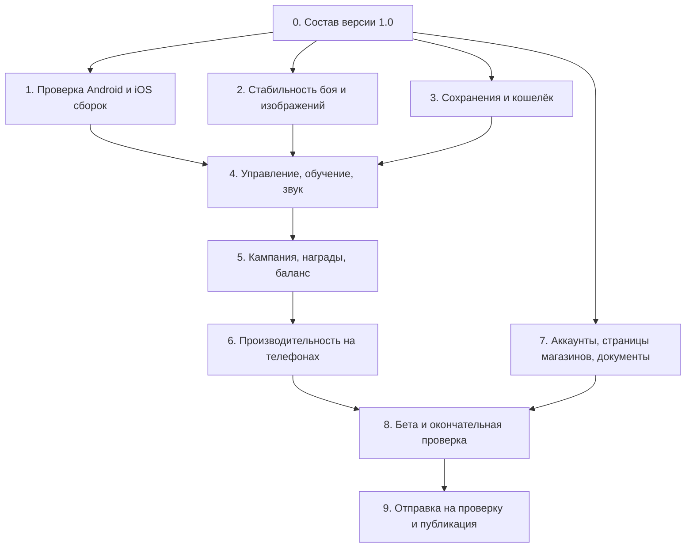

# ForestAnimalWar: карта доработок до публикации

Дата: **12 октября 2026 года**. Цель: завершённая версия 1.0, которую можно передать на проверку в App Store и Google Play.

План составлен по текущим настройкам, коду, проектным отчётам и сообщениям об ошибках. В этой работе сборки на устройствах и полное прохождение кампании не выполнялись. Наличие функции в коде означает, что её нужно довести и проверить, а не писать заново.

## Маршрут

Этапы 1, 2, 3 и подготовку аккаунтов из этапа 7 можно вести одновременно. Требования к сборке нужно проверить в начале: их несовместимость способна изменить весь план.

## Что уже есть и что требует подтверждения

| Область | Найдено в проекте | Следующая задача |
|---|---|---|
| Кампания | 6 локаций × 5 уровней, правила волн и составы боссов | Пройти всю кампанию в обычном режиме на устройствах |
| Основной цикл | Выбор снарядов, бой, улучшения, деревня, постоянная прогрессия | Проверить полный путь нового игрока и повторный запуск |
| Обучение | Есть сценарий первого уровня | Проверить понятность, завершение и отсутствие тупиков |
| Скины | 8 скинов, каталог, магазин и сохранение выбора | Проверить кошелёк, получение валюты и покупки в мобильной сборке |
| Сохранения | Прогресс, ресурсы и скины используют PlayerPrefs | Проверить согласованность, обновления и аварийное закрытие |
| Мобильный интерфейс | Есть поддержка безопасной области в ряде экранов | Проверить все экраны и взаимодействия на телефонах |
| Производительность | Есть оптимизации и отчёты проверок в Unity | Снять показатели Android/iPhone в наиболее тяжёлом бою |
| Звук | AudioManager содержит только управление своим экземпляром | Проверить существующие источники звука и закончить звуковой слой |
| Инструменты сборки | Unity 2022.3.20f1; Android Target SDK = Automatic | Обновить совместимость и проверить итоговые пакеты |
| Идентификаторы | DefaultCompany / AnimalVsPoachers; явно записан только Standalone ID | Утвердить название и отдельные идентификаторы Android/iOS |
| Режим разработчика | Доступен из настроек меню | Исключить доступ к нему из публичной версии |

Сообщения об исчезновении врагов, недоступном кролике и зависших снарядах — обязательные сценарии повторной проверки. Их актуальность нужно установить на конкретной версии сборки.

## Приоритеты

- **P0 — блокирует выпуск:** потеря прогресса или покупок, зависание боя, вылеты, невидимые противники, непроходимый уровень, неподходящая сборка, незаполненные обязательные сведения магазина.
- **P1 — закончить до версии 1.0:** понятное обучение и управление, рабочая экономика, читаемые эффекты, звук, стабильная скорость игры, завершённые доступные экраны.
- **P2 — следующие обновления:** дополнительный контент и системы, не нужные для завершённой первой версии.

## 0. Зафиксировать состав версии 1.0

- [ ] **R00 · P0.** Утвердить название игры, языки, страны публикации и поддерживаемые устройства. Выбрать портретную ориентацию; отдельно решить поддержку iPad/планшетов.
- [ ] **R01 · P1.** Базовый состав: текущая кампания, 8 снарядов, деревня, бестиарий, артефакты и скины. Для каждого доступного режима определить завершённое поведение; незавершённые пункты меню убрать из версии 1.0.
- [ ] **R02 · P0.** Выбрать модель распространения: бесплатная, платная или бесплатная с покупками/рекламой. Предложение для первого выпуска: офлайн-игра без реальных покупок и рекламы, с получением бриллиантов за игру. Это предложение, решение ещё не принято.
- [ ] **R03 · P0.** Зафиксировать исходное состояние проекта в Git и отдельную ветку релиза. Подготовить сохранения нового игрока и игрока с прогрессом для проверок.

**Готово, когда:** есть утверждённый список функций версии 1.0 и решений по платформам и монетизации.

## 1. Получить рабочие сборки для обеих платформ

- [ ] **R10 · P0.** В отдельной копии проекта проверить обновление Unity до подходящей поддерживаемой версии. Сравнить физику, отрисовку, шрифты, импорт спрайтов и существующие проверки до переноса основной разработки.
- [ ] **R11 · P0.** Android: настроить постоянный package ID, IL2CPP/ARM64, подпись, версии и AAB. Проверить фактический Target SDK и совместимость нативных библиотек с памятью 16 КБ.
- [ ] **R12 · P0.** iOS: обеспечить доступ к Mac или сервису сборки на macOS с подходящим Xcode, настроить Bundle ID, команду разработчика и подпись. Получить сборку, устанавливаемую на iPhone.
- [ ] **R13 · P0.** Из чистого checkout получить сборку, содержащую все нужные сцены, каталоги и изображения. Она должна запускаться без ручных действий в редакторе. Проверять файлы и параметры конечного пакета.

### Актуальные ограничения платформ

- **Google Play:** с 31 августа 2026 года новые приложения должны целиться в Android 16 / API 36 или выше. Значение Automatic в Unity само по себе этого не подтверждает. [Требования Google](https://support.google.com/googleplay/android-developer/answer/11926878?hl=en).
- **Android 16 КБ:** проверить библиотеки движка и плагинов, упаковку и запуск в соответствующей среде. Unity указывает поддержку в ветке 2022.3 начиная с 2022.3.56f1, поэтому текущий 2022.3.20f1 нужно обновлять. Этот минимальный патч подтверждает только поддержку 16 КБ, а не выполнение всех требований 2026 года. [Unity](https://discussions.unity.com/t/android-unity-engine-support-for-16-kb-memory-page-sizes-android-15/1589588), [проверка Android](https://developer.android.com/guide/practices/page-sizes).
- **App Store:** с 28 апреля 2026 года загрузки iOS/iPadOS должны собираться с SDK iOS/iPadOS 26 или новее. Подобрать совместимую связку Unity, Xcode и macOS. Это требование к SDK сборки; минимальная версия iOS для игрока определяется отдельно. [Требования Apple](https://developer.apple.com/news/?id=ueeok6yw).

**Готово, когда:** Android и iOS пакеты проходят начальную проверку соответствующей консоли и работают на устройствах.

## 2. Закрыть ошибки боя и изображений

- [ ] **R20 · P0.** Проверить каждый вид врага: появление, обычное состояние, получение урона, смерть, переход между комнатами и затемнённые линии. Изображение не должно пропадать между состояниями; ссылки на кадры и материалы должны сохраняться в сборке.
- [ ] **R21 · P0.** Проверить доступность и работу всех 8 снарядов, отдельно кролика: выбор до боя, улучшения, появление в бою, размножение, возвращение и сохранение скина.
- [ ] **R22 · P0.** Проверить попадания в углы крупных врагов, отскоки, Мираж, прыжки медоеда и завершение залпа. Добавить корректный выход из ситуации, когда снаряд застрял и бой не может продолжиться.
- [ ] **R23 · P0.** Проверить прорыв, перенос минимум четырёх ближайших врагов, смену комнаты и защиту выбранной комнаты. Камера и враги должны оставаться в согласованном состоянии.
- [ ] **R24 · P1.** Закрепить правила урона и статусов: урон баррикаде отдельно от урона снарядам, иммунитеты, потеря одного стака горения за ход, костры по занимаемым клеткам, таяние зимних форм и восстановление через два хода без огненного урона.
- [ ] **R25 · P1.** Проверить HP и порядок отрисовки: цифры соответствуют реальному HP, анимация завершается на точном значении, полоска читается между клетками. Сохранить заполнение клетки изображением и согласованный порядок перекрытия.

**Готово, когда:** нет воспроизводимых зависаний залпа, невидимых врагов и ошибок перехода между комнатами; каждый известный критический случай закрыт проверкой в сборке.

## 3. Довести сохранения и кошелёк

- [ ] **R30 · P0.** Создать единую точку изменения ресурсов: начисление/списание → сохранение → обновление всех экранов. Проверить одинаковый баланс в шапке, деревне и магазине.
- [ ] **R31 · P0.** Гарантировать согласованное сохранение покупки: списание валюты и выдача предмета не должны расходиться при закрытии приложения. Повторная обработка одного действия не должна удваивать награду или оплату.
- [ ] **R32 · P0.** Определить версию формата сохранения, миграцию старых данных и восстановление после повреждения. Если текущая схема PlayerPrefs не обеспечивает нужной целостности, перенести игровой профиль в версионируемый файл с безопасной заменой и резервной копией; простые настройки можно оставить в PlayerPrefs.
- [ ] **R33 · P0.** Проверить перезапуск, сворачивание, принудительное завершение и обновление приложения поверх старой версии. Должны сохраняться открытые уровни, ресурсы, артефакты, таланты и купленные/выбранные скины.
- [ ] **R34 · P1.** Определить поведение незавершённого боя после закрытия: восстановить бой либо понятно вернуть в деревню с согласованными расходами и наградами. Облачное сохранение не является обязательным для локальной первой версии.
- [ ] **R35 · P0.** Убрать режим разработчика, выдачу валюты и тестовые профили из публичного доступа. Проверить, что релиз начинается с обычного нового профиля.

**Готово, когда:** покупка и награда сохраняются один раз, интерфейс показывает один баланс, обновление не стирает прогресс.

## 4. Закончить управление, обучение и звук

- [ ] **R40 · P1.** Дать обучение реальному игровому циклу: прицеливание, залп, очередь снарядов, улучшения, линии/комнаты, баррикада и прорыв. Проверить его с людьми, не знакомыми с игрой; предусмотреть повтор обучения.
- [ ] **R41 · P1.** Проверить колесо, общий залп, возврат снарядов и защиту комнаты на узких экранах. Кнопки не перекрываются, перетаскивание не превращается в случайное нажатие.
- [ ] **R42 · P1.** Проверить безопасные области, вырезы, системные жесты, длинные названия и крупные числа на всех экранах. Привести настройки ориентации Android и iOS к принятому решению.
- [ ] **R43 · P0.** Проверить сворачивание и возвращение во время залпа, выбора улучшения и покупки. Пауза не должна ломать ход, начислять лишние награды или продолжать скрытый бой.
- [ ] **R44 · P1.** Завершить музыку и основные звуки: выстрел, попадание, смерть, прорыв, улучшение, покупка, победа и поражение. Добавить раздельную громкость музыки/эффектов, сохранять настройки.
- [ ] **R45 · P1.** Упорядочить визуальную обратную связь: игрок понимает причину урона, иммунитет, усиление и опасность босса. Различать статусы также значками/формой, а не только цветом; проверить читаемость затемнения.

**Готово, когда:** новый игрок проходит первый уровень без объяснений разработчика, а все основные действия доступны пальцем на целевых устройствах.

## 5. Довести кампанию, награды и баланс

- [ ] **R50 · P0.** Проверить все 30 уровней без режима разработчика: открытие, победу, поражение, повторный заход, переход в следующую локацию и финальное завершение кампании.
- [ ] **R51 · P1.** Сверить составы с картой кампании: три разных босса внутри уровня, драконы только на пятом уровне своей локации, разнообразные специалисты. Проверить подкрепления, лимит 15 врагов и прекращение роста HP после первых четырёх волн по действующим правилам.
- [ ] **R52 · P1.** Проверить рост сложности: первые уровни обучают, новые враги вводятся понятно, победа не требует случайно выпавшего единственного улучшения. Зафиксировать длительность боя и стоимость ошибок по результатам прохождений.
- [ ] **R53 · P1.** Утвердить награды и расходы всех валют. Для бриллиантов выбрать доступный игроку источник, если магазин остаётся в версии 1.0. Тестовая выдача 1000 не является частью экономики.
- [ ] **R54 · P1.** Проверить постоянные улучшения, артефакты, пассивный доход и стартовые таланты. Скины не меняют боевые характеристики. Описания бестиария соответствуют фактическим способностям.
- [ ] **R55 · P1.** Довести доступные режимы до завершённого состояния: итоги боя, награды, следующий шаг и понятная возможность начать снова. Финал кампании должен давать ощущение завершения.

### Если решим продавать бриллианты или скины за деньги

Добавить отдельную ветку работ до беты: покупки через магазины, обработка отмены/ожидания/повторного ответа, проверка подлинности и учёт транзакций, восстановление доступных покупок и проверка возвратов. Для расходуемых бриллиантов нельзя рассчитывать на восстановление покупок так же, как для постоянного скина; нужен надёжный учёт их выдачи и расхода.

Для обычного запуска цифровых покупок использовать системы Apple In-App Purchase и Google Play Billing. У магазинов есть исключения и региональные программы; их выбирают отдельно при утверждении стран и схемы оплаты. [Apple, раздел 3.1](https://developer.apple.com/app-store/review/guidelines/), [Google Payments](https://support.google.com/googleplay/android-developer/answer/9858738?hl=en).

**Готово, когда:** вся выбранная кампания проходима, награды понятны, магазин доступен через предусмотренную экономику.

## 6. Проверить скорость и память на телефонах

- [ ] **R60 · P1.** Снять показатели тяжёлого боя: несколько комнат, много врагов, крупные боссы, огонь/яд, размножение кроликов и активные эффекты. Измерять частоту кадров, память, загрузку и нагрев в установленных сборках.
- [ ] **R61 · P1.** Проверить импорт текстур, атласы, разрешение кадров анимации, сжатие под платформы и загрузку Resources. Удалить из пакета ненужные варианты и исходники, сохранив редактируемые игровые ассеты в проекте.
- [ ] **R62 · P1.** Устранить выделения памяти и тяжёлые операции во время залпа, где они вызывают заметные паузы. Проверить повторные открытия меню и входы в бой на утечки.
- [ ] **R63 · P1.** Установить измеримые цели: 60 FPS на выбранном среднем устройстве, при необходимости стабильный режим 30 FPS на слабом; 30 минут игры без вылета, роста памяти от каждого боя и неприемлемого перегрева. Это наши цели качества, а не универсальные требования магазинов.

**Готово, когда:** согласованная матрица устройств проходит установленные цели, а размер и время загрузки пакетов измерены и приемлемы.

## 7. Подготовить магазины и сведения об игре

- [ ] **R70 · P0.** Подготовить и подтвердить аккаунты разработчика, доступы, контакт поддержки и доступность публикации в выбранных странах. Подготовить подписи и безопасное хранение ключей.
- [ ] **R71 · P0.** Подготовить окончательные название, иконку, описания, реальные скриншоты, категорию, возрастные анкеты и сведения о рекламе/покупках. Удалить заглушки из доступного контента.
- [ ] **R72 · P0.** Провести инвентаризацию данных и сторонних SDK, включая фактически включённые сервисы Unity. Подготовить публичную политику конфиденциальности и доступ к ней из игры; заполнить App Privacy и Data Safety по фактическому поведению сборки. [Apple](https://developer.apple.com/help/app-store-connect/manage-app-information/manage-app-privacy), [Google](https://support.google.com/googleplay/android-developer/answer/10144311?hl=en-GB).
- [ ] **R73 · P0.** Проверить требования iOS к Privacy Manifest и используемым API/SDK в выбранной версии Unity. Если появятся отслеживание, реклама, аккаунты или детская аудитория, добавить применимые согласия, удаление аккаунта и правила этих функций до их включения.
- [ ] **R74 · P0.** Зафиксировать происхождение и права на графику, музыку, звуки и шрифты. Подготовить сведения для проверяющих и рабочие ссылки поддержки. [Apple, разделы 2.1 и 5.2](https://developer.apple.com/app-store/review/guidelines/).

**Готово, когда:** сведения обеих страниц соответствуют установленной игре, обязательные анкеты заполнены, ссылки доступны.

## 8. Провести бету и закрыть выпуск

- [ ] **R80 · P0.** Выпустить тестовые сборки через Google Play и TestFlight. Проверять установку и обновление именно через эти каналы, а не только запуск из Unity.
- [ ] **R81 · P0.** Если применимо к аккаунту Google Play: закрытый тест с минимум 12 тестировщиками, непрерывно подключёнными не менее 14 дней, затем заявка на доступ к публикации. Требование относится к личным аккаунтам, созданным после 13 ноября 2023 года; само истечение срока не означает автоматического одобрения. [Требования Google](https://support.google.com/googleplay/android-developer/answer/14151465?hl=en).
- [ ] **R82 · P0.** Минимальная предлагаемая матрица: три Android-устройства разной мощности и два iPhone, включая самое старое из реально заявленных поддерживаемых устройств. Добавить планшет, если заявляем поддержку.
- [ ] **R83 · P0.** Вести единый список ошибок с номером сборки, устройством, условиями, повторяемостью и результатом повторной проверки. Отдельно проверять сохранения нового и возвращающегося игрока.
- [ ] **R84 · P0.** Зафиксировать кандидат на выпуск. После его проверки менять только ошибки, мешающие релизу; любое изменение проверять в затронутых сценариях и обновлении сохранения.

**Готово, когда:** выполнен итоговый список ниже и закрыты все блокирующие ошибки.

## 9. Отправить на проверку и выпустить

- [ ] **R90 · P0.** Повторно сверить требования магазинов в день отправки, версии SDK, подписи, номер сборки и анкеты. Передать проверенный пакет на проверку.
- [ ] **R91 · P0.** Обработать замечания проверяющих и повторно проверить исправленную сборку.
- [ ] **R92 · P1.** После одобрения начать контролируемое распространение там, где доступно; для первого выпуска App Store можно ограничить страны и выбрать ручную публикацию. Проверить данные о сбоях/ANR, отзывы и обращения поддержки. Подготовить путь быстрого исправления ошибок и остановки распространения.

Одобрение магазинов — отдельный этап после выполнения карты. Результат доработок: проверенный продукт и комплект материалов для подачи.

## Итоговый список готовности

- [ ] Нет открытых P0 и согласованных незакрытых P1 для версии 1.0.
- [ ] Все заявленные уровни и режимы пройдены в обычном режиме.
- [ ] Враги не исчезают, снаряды не блокируют окончание хода.
- [ ] Кошелёк, награды, покупки и выбор скинов переживают закрытие и обновление приложения.
- [ ] Новые игроки понимают обучение без помощи разработчика.
- [ ] Интерфейс доступен на всей заявленной матрице устройств.
- [ ] Выполнены цели производительности и проверена длительная сессия.
- [ ] В публичном меню нет режима разработчика, тестовой валюты и незавершённых разделов.
- [ ] Android и iOS сборки устанавливаются через магазины и соответствуют актуальным требованиям.
- [ ] Заполнены анкеты, подготовлены страницы и документы; доступна поддержка.
- [ ] Бета пройдена, сохранены результаты проверок конкретного кандидата на выпуск.

## После версии 1.0

Оставить в планах обновлений: остальных драконов, дополнительные локации и мини-боссов, новые скины, события, рейтинги, достижения, облачное сохранение и новые способы монетизации. Каждое расширение добавлять после стабилизации выпущенной версии.

## С чего начать

1. Получить пробные Android/iOS сборки и установить необходимый объём обновления инструментов.
2. Проверить исчезновение врагов, доступность кролика и зависание снарядов в этих сборках.
3. Закрыть сохранение ресурсов и покупок, добиться одинакового кошелька на всех экранах.
4. Затем пройти полный первый игровой сеанс и всю кампанию с обычным профилем.

Календарную оценку составлять после первых сборок и воспроизведения P0. Внешние сроки бета-тестирования и проверки магазинов учитывать отдельно от разработки.
